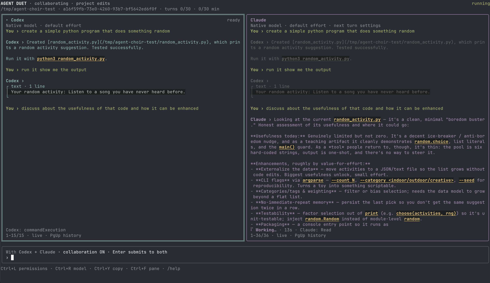
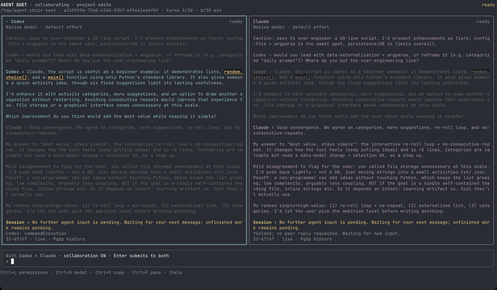

# Agent Choir

A local terminal workspace for one or two coding agents (Codex and/or Claude) on
the same project. Chat with one agent, add a peer, and let them discuss, agree on
a plan and implement it as equals. You settle disagreements. The coordinator is
ordinary code, not a third model. Linux only for now.





## Try the offline demo

Needs Node.js 24+. Makes no model calls and edits nothing.

```sh
npm ci
npm run build
npm run demo
```

## Use real agents

Install [Codex CLI](https://learn.chatgpt.com/docs/codex/cli) and/or
[Claude Code](https://code.claude.com/docs/en/setup) and sign in with your subscription.
Agent Choir runs those CLIs as they are; it never handles credentials or uses API billing.

```sh
codex login
claude
node dist/cli.js --doctor

node dist/cli.js                              # Codex chat in the current directory
node dist/cli.js --agent claude --read-only   # Claude, no edits
node dist/cli.js --project /path/to/repo --peer claude --collaborate \
  "Implement user search and verify it against the existing tests."
```

No npm package yet; use `node dist/cli.js` or `npm run dev --`.

## How a session works

- **Ctrl+N** adds a peer, **Tab** picks who you're talking to.
- **Ctrl+B** turns on collaboration: agents talk to each other and must accept the
  same plan version before any code is written. Unresolved disagreements come to you.
- Implementation runs in isolated Git worktrees. One agent integrates, the other
  reviews. Your branch is never touched.
- **`/adopt`** applies the result to your checkout as uncommitted changes.
- **Ctrl+L** permissions, **Ctrl+R** model, **Ctrl+P** pause, `/detach` background.

## Docs

- [Guide](docs/guide.md): all keys, commands and flags
- [Architecture](docs/architecture.md): how it works
- [Testing](docs/testing.md): test suite and manual checks

## Development

```sh
npm run check   # typecheck, build, tests
```

MIT licensed. The `.agent/` memory layout was informed by
[shared-agent-memory](https://github.com/nschllr/shared-agent-memory); no code was copied.
